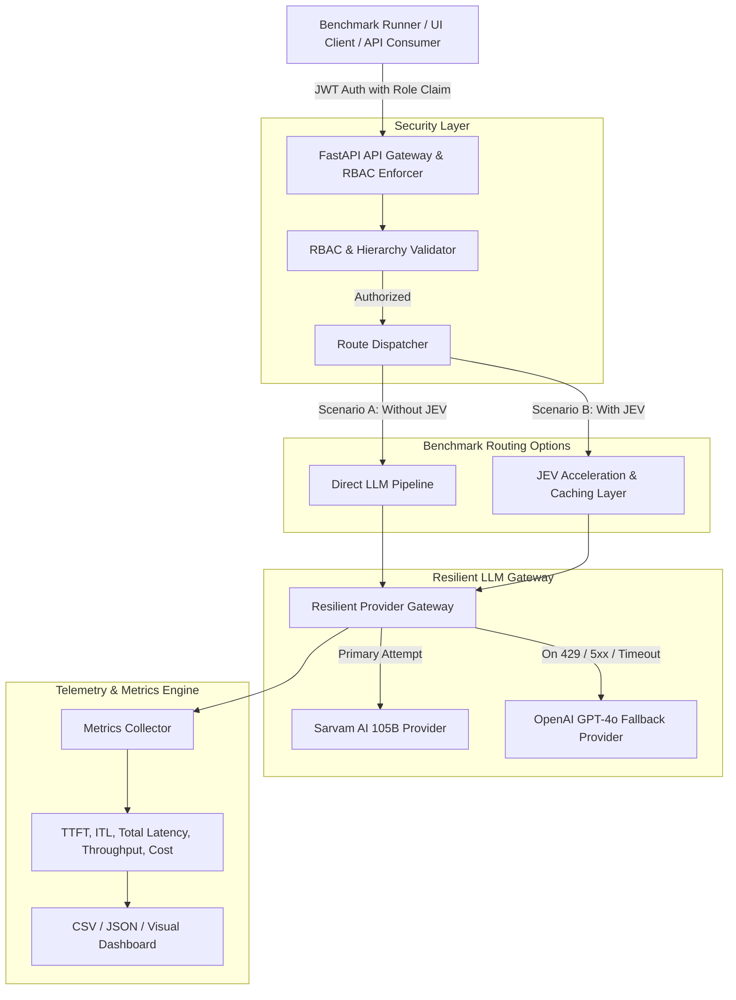
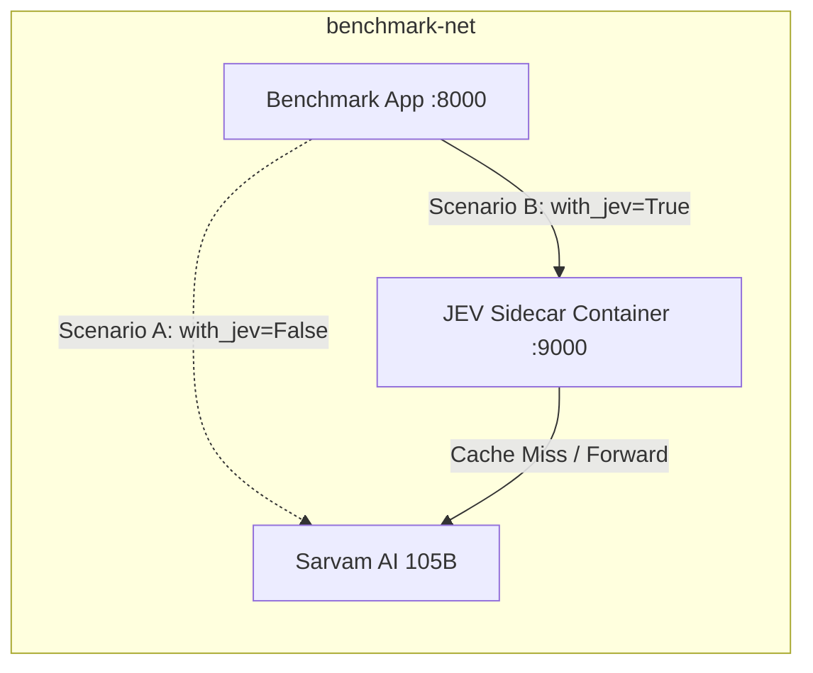

# System Architecture: LLM Benchmarking with & without JEV

This document outlines the architectural blueprint for benchmarking an LLM-hosted application running **Sarvam AI (105B)** as the primary model, comparing performance **with JEV** vs. **without JEV**, with automatic **OpenAI fallback**.

---

## 1. High-Level Architecture Overview



---

## 2. Benchmark Scenarios Explained

### Scenario 1: Baseline (Without JEV)
* **Execution Path:** The request flows directly through standard asynchronous HTTP/gRPC pipelines to Sarvam AI.
* **Characteristics:** Standard cold-start overhead, baseline TTFT, standard KV-cache handling by the upstream provider, raw API latency.
* **Purpose:** Serves as the control group to establish raw model baseline.

### Scenario 2: Optimized (With JEV)
* **Execution Path:** The request passes through the **JEV (Optimization/Acceleration) Layer**.
* **JEV Capabilities Benchmarked:**
  * Context caching and prefix-tree matching for prompt reuse.
  * Speculative execution or dynamic batch scheduling (if JEV runtime inference is used).
  * Connection pooling and keep-alive optimization.
* **Purpose:** Quantifies latency reduction, throughput enhancement, and resource efficiency delivered by JEV.

---

## 3. Resilient LLM Provider Strategy

1. **Primary: Sarvam AI 105B**
   * Configured via `SARVAM_BASE_URL` and `SARVAM_API_KEY`.
   * Evaluated across multilingual prompts, Indian language context benchmarks, and high-concurrency synthetic loads.
2. **Fallback: OpenAI (`gpt-4o` / `gpt-4o-mini`)**
   * Activated automatically using circuit breakers and exponential backoff retry policies.
   * Ensures uninterrupted SLA and benchmark stability.
   * Emits structured audit events whenever a fallback transition occurs.

---

## 4. Hosting Architecture: Docker Sidecar Microservice

JEV is hosted as an independent microservice container that runs alongside the benchmark application:



* **Service 1 (`jev-engine` on port 9000):** High-performance sidecar proxy container managing prompt prefix hashing, KV-cache acceleration, and latency headers (`X-JEV-Cache`, `X-JEV-Latency-MS`).
* **Service 2 (`benchmark-app` on port 8000):** FastAPI application with hierarchical RBAC, dynamic routing adapter, benchmark worker pool, and dashboard UI.

---

## 5. Path and Data Portability

* **Zero Local Path References:** All data sets, result exports, and test fixtures are referenced relative to project root dynamically:
  ```python
  from pathlib import Path
  PROJECT_ROOT = Path(__file__).resolve().parents[2]
  DATA_DIR = PROJECT_ROOT / "data"
  ```
* **Git Safe:** No machine-specific path (`/home/user`, Windows local directories) or developer credentials exist in any file.
